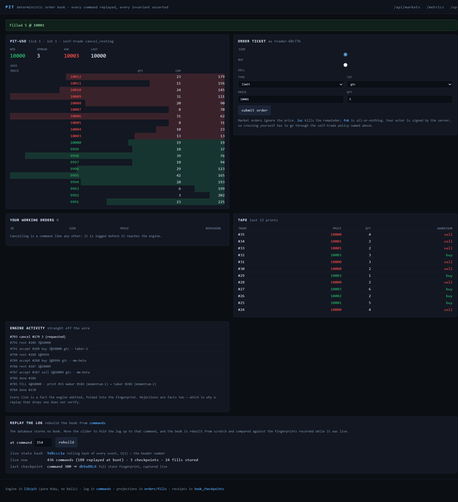

# PIT

**A deterministic, replayable limit-order-book matching engine, served by Rails 8 and one SQLite file.**

A price–time priority order book in Ruby: limit and market orders, `GTC`/`IOC`/`FOK`, amends that keep or
lose their queue position, self-trade prevention, and a live ladder in the browser over Action Cable.
Every command is appended to a durable log *before* the engine sees it, so any past state of the book is
one fold away — and a replay can be **proved** to have reproduced history, because the fingerprint of the
book was recorded live as it happened.

> The interesting part isn't the trading. It's the architecture: a pure-Ruby engine with no Rails in it, a
> write-ahead log that makes the database the source of truth, a replay that verifies itself, and a tick
> loop that publishes but never matches.



---

## Why this is worth a look

| Concept | Where it lives |
|---|---|
| **Pure-Ruby matching engine** — no Rails, no clock, no I/O, no `Kernel#rand` | `lib/pit/` |
| **Deterministic by construction** — seeded PRNG, engine-assigned order ids, FNV-1a fingerprint | `lib/pit/prng.rb`, `lib/pit/engine.rb`, `lib/pit/hasher.rb` |
| **Write-ahead log** — a command is durable before the engine applies it | `MarketFeed#apply`, `commands` table |
| **Replay with receipts** — the book is rebuilt from the log and checked against fingerprints captured live | `MarketReplay`, `book_checkpoints`, `lib/pit/replayer.rb` |
| **Resume on boot** — restart the process and the market comes back exactly as it was | `MarketFeed#warm_up!`, `config/initializers/pit_engine.rb` |
| **Fixed-rate publish tick** at 10 Hz that never matches and never waits for the database | `MarketFeed#tick`, `PersistMarketEventsJob` |
| **Invariants asserted, not assumed** — 14 checks, exercised after *every* command in the fuzz suite | `lib/pit/invariants.rb` |
| **Server-authoritative clients** — the socket carries state down; commands go up over HTTP | `OrderBookChannel`, `OrdersController` |
| **Ownership enforced in the engine** — you can only cancel or amend your own orders, and a foreign order is indistinguishable from an unknown one | `Engine#owned_order`, `test/lib/pit/ownership_test.rb` |
| **Zero infrastructure** — SQLite, no Redis, no broker, no build step | `config/database.yml`, `propshaft`, `config/cable.yml` |
| **Observability** — hand-rolled Prometheus exposition at `/metrics` | `MarketMetrics` |
| **Measured, not asserted** — every speed claim comes from `bin/bench` | `bin/bench`, [docs/BENCHMARKS.md](docs/BENCHMARKS.md) |

### Verified behaviour

Measured against a running instance on the machine in [docs/BENCHMARKS.md](docs/BENCHMARKS.md)
(Ruby 3.4.7, **no YJIT**, SQLite in WAL mode):

- **A restart reproduces the book exactly.** A 25-second run accepted 188 commands; the next process
  replayed those 188 commands from the log alone and printed the same fingerprint (`ed3d9714`), the same
  58 resting orders and the same touch (10001 / 10004).
- **The replay verifies itself.** `GET /api/books/PIT-USD/replay` reported `faithful: true`,
  `1 checkpoint verified, 0 mismatched`, and `matchesLive: true` — the rebuild agreed with the book that
  was live at that moment.
- **The tick is cheap.** p50 / p95 / p99 = 0.573 / 3.163 / 8.043 ms per published frame at 10 Hz over 200
  frames — after moving the O(book) fingerprint off the tick path, where it had cost 90 ms a frame.
- **The engine is fast where it matters.** 36,641 commands/s on a 20k-command fuzz stream, and every one
  of the 14 invariants held throughout.
- **Ownership was a real bug, found by using it.** The engine used to let any actor amend or cancel any
  order — the synthetic flow was quietly amending the browser's orders. It is refused now, and
  `ownership_test.rb` plus an API test keep it that way.

---

## Quick start

Requires **Ruby 3.4+**. Nothing else — no Redis, no Postgres, no Docker, no Node.

```bash
git clone https://github.com/pattygcoding/pit.git
cd pit
bundle install
bin/rails db:prepare     # creates storage/development.sqlite3 and seeds two markets
bin/rails server         # then open http://localhost:3000
```

The market is alive when you open it: a seeded synthetic flow trades through the same order-entry path as
a human, so its commands are in the log too. Submit an order, cancel one of your working orders, then open
the **replay** panel and fold the log back through history.

```bash
bin/rails test          # engine + Rails layers, no Docker
bin/rails test:engine   # just lib/pit, booting no Rails at all
bin/bench               # every number quoted in this file
bin/rails pit:bench     # the same write path through Active Record, for comparison
```

Other endpoints worth hitting by hand: `/api/markets`, `/api/books/PIT-USD`,
`/api/books/PIT-USD/replay?at=100`, `/api/books/PIT-USD/fills`, `/metrics`, `/up`.

---

## Architecture

```
              browser (ladder · tape · ticket · replay scrubber — no build step)
                          │  commands: POST /books/:symbol/orders      (durable first)
                          │  state:    Action Cable — snapshots @10 Hz, events, your orders
                          ▼
┌────────────────────────────────────────────────────────────────────────────────────────────┐
│  OrdersController ──▶ OrderEntry          shape validation; the actor comes from the cookie   │
│                            │                                                                 │
│                            ▼                                                                 │
│  MarketFeed#apply                             ONE LOCK PER MARKET                            │
│     ├─ INSERT INTO commands                   ← durable *before* the engine matches            │
│     ├─ PIT::Engine#apply(command)             ← pure Ruby, deterministic, returns events       │
│     └─ buffer the events                      the caller's acknowledgement already has fills   │
│                                                                                              │
│  MarketFeed#tick  (one thread, 10 Hz)                                                        │
│     ├─ drain the buffer under the lock → one snapshot frame + one event frame                 │
│     ├─ broadcast → pit:market:<symbol> and pit:actor:<trader>                                │
│     └─ PersistMarketEventsJob.perform_later   ← the tick never writes to the database         │
│                                                                                              │
│  PersistMarketEventsJob   fills · order projections · book checkpoints                        │
│  MarketReplay             fold the log → the book at any command → verify its fingerprints    │
│  EngineRegistry           one MarketFeed per instrument, in process                           │
│  MarketMetrics            /metrics, Prometheus text, hand-rolled                              │
└────────────────────────────────────────────────────────────────────────────────────────────┘
             storage/development.sqlite3   (WAL · commands · orders · fills · book_checkpoints)
```

Two design choices carry the whole thing:

1. **A command is durable before the engine sees it, and both happen under the same lock.** That one
   ordering rule is what makes a replay *exact* rather than approximately exact: the log's order is the
   engine's order, and nothing else may mutate the engine. It costs one committed `INSERT` per accepted
   command (~0.36 ms with logging quiet, measured) and a lock that serialises writers.
2. **The tick only publishes.** Matching happens synchronously on the thread that accepts the order, so an
   acknowledgement already contains its fills; the ticker coalesces state into frames and hands
   persistence to a job. A slow database cannot stretch a frame, and the frame carries no O(book) work.

Because the server owns the truth, the browser cannot cheat: it can only *ask* for an order, and the actor
it trades as comes from a signed cookie the server issued, never from the request body.

---

## The matching rules

`lib/pit/engine.rb` — the contract, in the order a reviewer will want to check it:

| Rule | Behaviour |
|---|---|
| Price priority | Better price first; bids descending, asks ascending |
| Time priority | At one price, arrival order (the level is a FIFO queue) |
| Resting | A limit order that cannot trade rests at its price |
| Market orders | Never rest; the remainder is cancelled (`no_liquidity`) |
| `gtc` | Rests until filled or cancelled |
| `ioc` | Fills what it can now, cancels the remainder |
| `fok` | All-or-nothing: the liquidity is checked *before* anything trades |
| Fill price | The **maker's** price — the taker gets price improvement |
| Amend, same price | Keeps its place in the queue |
| Amend, new price | Loses its place, and may trade on re-entry |
| Cancel | Removes exactly the remainder; a filled order is not cancellable |
| Self-trade prevention | `cancel_resting` (cancel our resting order, keep matching), `skip` (stop, and kill our remainder), or `off` |
| Ownership | Only the order's own actor may cancel or amend it; a foreign order is answered exactly like an unknown one |
| Validation | Positive quantities in lot multiples; prices positive and on-tick; a market order must not carry a price |

Rejections are events, not exceptions: every refusal is emitted as `Events::Rejected` with a reason, folded
into the fingerprint, and shown in the browser's activity log. That is deliberate — a replay that drops a
rejection must fail to verify.

---

## Wire protocol

Endpoint: `ws://localhost:3000/cable`, channel `OrderBookChannel` with `{ symbol: "PIT-USD" }`.

**Server → client** (state only — there is no way to trade over the socket)

| Type | Payload | When |
|---|---|---|
| `snapshot` | `seq`, `tradeSeq`, `stateHash`, `bids[]`, `asks[]`, `bestBid`, `bestAsk`, `spread`, `mid`, `lastTradePrice`, `restingOrders`, `commandCount`, `tape[]` | once on connect, then 10 Hz |
| `events` | `events[]` — `accepted`, `fill`, `rested`, `cancelled`, `amended`, `done`, `rejected`, each with its sequence number | every tick that produced events |
| `yourOrders` | `orders[]` — your working orders, with `orderId`, `side`, `price`, `remaining` | only to the trader whose orders changed |
| `hello` | `symbol`, `trader`, `tickRate` | once on connect |

`stateHash` is the rolling hash of every event so far — O(1) to read, which is why it is what the tick
carries. The full state fingerprint is not sent at 10 Hz: see [docs/BENCHMARKS.md](docs/BENCHMARKS.md) for
what that cost.

**Client → server:** nothing. Commands travel over HTTP, so they can be durable before they reach the
engine, and so a double-clicked ticket is idempotent rather than traded twice.

---

## REST API

| Method | Path | Description |
|---|---|---|
| `GET` | `/api/markets` | every market this process is running, with counters and fingerprints |
| `GET` | `/api/books/:symbol` | the live book, top 10 levels by default (`?levels=`, `?tape=`), with the full fingerprint |
| `GET` | `/api/books/:symbol/replay` | **rebuild the book from the log**, verify its checkpoints, and report whether the rebuild matches the live book |
| `GET` | `/api/books/:symbol/replay?at=2500` | the book exactly as it was after command 2,500 |
| `GET` | `/api/books/:symbol/fills` | the tape as persisted by the background job |
| `POST` | `/books/:symbol/orders` | submit (the ticket's form) |
| `PATCH`/`DELETE` | `/books/:symbol/orders/:order_id` | amend / cancel one of *your* orders |
| `GET` | `/metrics` | Prometheus text |
| `GET` | `/up` | health check |

```console
$ curl -s localhost:3000/api/books/PIT-USD/replay | jq '{replayedCommands, events: .replayedEvents, faithful, checkpointsVerified, matchesLive, replayMs}'
{
  "replayedCommands": 188,
  "events": 342,
  "faithful": true,
  "checkpointsVerified": 1,
  "matchesLive": true,
  "replayMs": 23.8
}
```

That call is the whole project in one request: 188 commands folded from scratch, 342 events reproduced, a
fingerprint recorded while the market was live matched, and the result compared against the book running
in memory right now.

---

## Observability

`/metrics` is hand-rolled Prometheus text — no gem, no exporter, nothing that can drift from what the code
actually measures.

| Metric | Type | Meaning |
|---|---|---|
| `pit_commands_total` | counter | commands accepted (logged *and* applied) |
| `pit_fills_total` | counter | prints executed |
| `pit_filled_quantity_total` | counter | lots that changed hands |
| `pit_rejected_total` | counter | commands the engine refused |
| `pit_self_trade_cancels_total` | counter | self-trade prevention firing |
| `pit_resting_orders` / `pit_resting_quantity` | gauge | the book right now |
| `pit_best_bid` / `pit_best_ask` / `pit_last_trade_price` | gauge | the touch and the last print |
| `pit_tick_duration_ms{p50,p95,p99}` | summary | one publish tick, sampled in-process |
| `pit_snapshot_frames_total` | counter | frames broadcast |
| `pit_subscribers` | gauge | connected browsers |
| `pit_market_info{fingerprint,warm_up_commands,tick_rate}` | gauge (1) | **which state this process is holding, and how much log it replayed at boot** |

`pit_market_info` is the useful one in anger: two processes serving the same symbol with different
fingerprints means one of them is holding a different book, and now you can see it from a scrape.

---

## Time travel, and how it is verified

The database stores **no book**. It stores the commands that produced one:

```
commands            append-only write-ahead log — the source of truth
orders, fills       projections, rebuilt from the log; written off the matching path by a job
book_checkpoints    the fingerprint of the book after every 100 commands, captured live
```

So `MarketReplay` answers "what did the book look like at command 4,000?" by folding the log from the
start — 20,000 commands in ~0.8 s, or 25,000 commands/s. Because the engine is deterministic, the answer is
exact, and because `book_checkpoints` recorded fingerprints *while the market was live*, the answer can be
checked:

- `faithful` — every checkpoint recorded before that point was reproduced byte for byte;
- `matchesLive` — (whole-log replays only) the rebuild's fingerprint equals the fingerprint of the book
  running in memory right now.

Both are shown in the UI's replay panel and returned by the API. If someone edits a command's payload, the
checkpoints stop matching and `/api/books/:symbol/replay` says so — there is a test for exactly that
(`MarketReplayTest#test_a_tampered_log_cannot_pretend_to_be_history`).

---

## Testing

```bash
bin/rails test          # 48 engine tests + 54 Rails tests, 491 assertions, no Docker required
bin/rails test:engine   # only test/lib/**, loading lib/pit with no Rails at all
```

The engine suite is the highest-value one, and it is the one that runs without Rails:

- **`engine_test.rb`** — price and time priority, the maker's price, cancels, validation, and the
  determinism claims (`seed + commands ⇒ fingerprint`, and different seeds ⇒ different books).
- **`tif_test.rb`** — `gtc`/`ioc`/`fok` and market orders, including the remainder semantics.
- **`amend_test.rb`** — the amend rules: same price keeps queue position, new price loses it, and an amend
  into the market trades.
- **`ownership_test.rb`** — the bug that shipped and was caught: one actor cannot cancel or amend another's
  order, and a foreign order is indistinguishable from an unknown one.
- **`order_book_test.rb`** — ladder ordering, level aggregation, depth, the tape.
- **`replay_test.rb`** — 5 seeds × 250 fuzzed commands, asserting all 14 invariants after *every* command,
  plus replay/replay-from-truncation/replay-of-a-shuffled-log.

The Rails suite (`test/`) then checks the parts the engine cannot: that a command is in the log before the
engine sees it, that a duplicate command id is idempotent instead of a second trade, that warm-up resumes
from `max(position)` rather than a row count, that the tick hands persistence to a job rather than doing it,
that the actor never comes from the request body, and that the HTTP surface renders and reports everything
the README claims.

---

## Project layout

```
lib/pit/                      ★ PURE RUBY ENGINE — no Rails, no clock, no I/O
├─ prng.rb                    xorshift64*, high bits folded (nearby seeds diverge immediately)
├─ hasher.rb                  FNV-1a 32-bit, integers folded as words
├─ config.rb                  tick/lot/self-trade, and its signature is part of the fingerprint
├─ commands.rb, events.rb     immutable values; commands are intent, events are facts
├─ order.rb, price_level.rb   the hot-loop objects; actor hash precomputed once
├─ order_book.rb              sorted ladders, binary-search insert, depth
├─ engine.rb                  the transition function: apply(command) → [events]
├─ invariants.rb              14 checks, asserted after every command in the fuzz suite
├─ replayer.rb                fold a log, and verify checkpoints in the same pass
└─ fuzz.rb                    seeded command generator (tests, benchmark, synthetic flow)

app/
├─ services/                  market_feed (lock + log + tick), engine_registry, order_entry,
│                             synthetic_flow, market_replay, market_metrics
├─ channels/                  order_book_channel (downstream only), connections from a signed cookie
├─ controllers/               books, orders, metrics, api/{books,replays,fills,markets}
├─ jobs/persist_market_events_job.rb
├─ javascript/controllers/market_controller.js    ladder/tape/ticket/replay over the socket
├─ views/books/show.html.erb                      one page, server-rendered first paint
└─ assets/stylesheets/application.css             hand-written, no build step

test/lib/**                   engine tests, no Rails          (bin/rails test:engine)
test/{services,models,channels,integration}/   Rails layers (bin/rails test)
bin/bench                     every number in docs/BENCHMARKS.md
docs/BENCHMARKS.md            measurements, methodology, and what is *not* measured
AGENTS.md                     the architecture contract and recipes — read this before editing
```

---

## Configuration

Two instruments are seeded, deliberately with different engines, because the configuration is part of the
fingerprint: `PIT-USD` (tick 1, lot 1, `cancel_resting`) and `PIT-EUR` (tick 5, lot 10, `skip`).

```yaml
# db/seeds.rb, overridable by environment
PIT_SYMBOL=PIT-USD PIT_SEED=20261104 PIT_RATE=6   # synthetic commands per second
PIT_EUR_SEED=4242  PIT_EUR_RATE=3
```

`MarketFeed` tuning lives as constants next to the code that uses them — `SNAPSHOT_HZ` (10), `CHECKPOINT_EVERY`
(100), `TAPE_LIMIT` (200) — with a comment explaining each, because they are read by tests and by anything
answering questions about the design.

---

## Roadmap

| Phase | Scope | Status |
|---|---|---|
| 0 | Rails 8 scaffold, SQLite (WAL), Solid Cable/Queue configured, no build step | ✅ |
| 1 | **Deterministic engine + invariant fuzz suite** (14 checks after every command) | ✅ |
| 2 | Write-ahead log, one lock per market, order entry with a server-issued actor | ✅ |
| 3 | 10 Hz publish tick over Action Cable, ladder/tape/ticket UI, synthetic flow | ✅ |
| 4 | Projections, checkpoints, `MarketReplay` with verification, `/metrics`, `bin/bench` | ✅ |
| 5 | `ownership` in the engine (ownerless cancels), regression suite, docs | ✅ |
| 6 | **Cross-process markets** — the log already makes this tractable: a second process can rebuild from `commands` and take over | next |
| 7 | Instruments as rows you can add at runtime, with a listing/creation API | planned |
| 8 | Load test (k6) with a tick-budget SLO; many-subscriber fan-out on `solid_cable` | planned |
| 9 | Stop orders and a risk gate (per-actor position and order limits) | planned |

---

## Known deliberate trade-offs

- **In-process markets.** `EngineRegistry` owns one `MarketFeed` per instrument in one process, like
  HEXARENA's `MatchCoordinator`. Two Puma workers would each hold their own book. The log makes fixing this
  a matter of replay-and-take-over rather than a redesign, but it is not done, and no claim is made for it.
- **One lock per market, held across a durable write.** Correctness first: the log's order is the engine's
  order. The price is lock contention between an accepting order and the publish tick — p95 3.2 ms at the
  default rate, ~40 ms at ten times it (measured, in `docs/BENCHMARKS.md`).
- **The state fingerprint is O(book).** It is computed where a receipt is wanted — checkpoints every 100
  commands, the REST read model, a replay's verdict — and never on the tick path. 23 ms on a 13k-order book
  is the honest cost of hashing all of it.
- **A 32-bit hash.** Chosen over 64-bit because Ruby's bignum boundary made the 64-bit version twice as slow
  for a divergence detector that does not need cryptographic strength. Written down where the choice lives.
- **HTTP for commands, not the socket.** It costs a round trip and buys durability order, idempotent
  double-clicks and ordinary form/CSRF handling. The socket is one-way by design.
- **`solid_cable` in production, `async` in development.** Development is a single process, so the in-memory
  adapter is exactly right; production uses the database-backed adapter the generator configured. No Redis
  anywhere.
- **No authentication.** Traders are identified by a signed cookie the server issues, which is enough to
  make self-trade prevention and ownership meaningful, and is not an identity system. `AGENTS.md` says where
  real auth would slot in.

---

## Licence

MIT — see [LICENSE](LICENSE).
